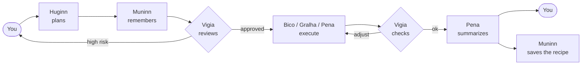

<p align="center">
  <picture>
    <source media="(prefers-color-scheme: dark)" srcset="assets/brand/dotcrow-logo-dark.svg">
    
  </picture>
</p>

<p align="center">
  <strong>An open source flock of AI agents that works on your computer.</strong><br>
  You hand over the whole task. The crows plan, act, check and learn.
</p>

<p align="center">
  <a href="https://github.com/napoleaomp4/dotcrow/actions/workflows/ci.yml"></a>
  <a href="LICENSE"></a>
  
  
  
  
</p>

<p align="center">
  <a href="#-quick-start">Get started</a> ·
  <a href="#-what-it-does">What it does</a> ·
  <a href="#-the-crows">The crows</a> ·
  <a href="#-the-crow-civilization-v2">Civilization</a> ·
  <a href="#-coming-next">Coming next</a> ·
  <a href="#-community-and-support">Community</a> ·
  <a href="#-contributing">Contributing</a> ·
  <a href="README.md">Português</a>
</p>

<br>

> [!WARNING]
> **Pre-alpha, built in public.** The crows already think and act with real LLMs, but there is a lot ahead and the cryptography has not been externally audited. Do not use it with production data or keys. **This is the best time to join:** the project is small enough for you to leave your mark on it. 🪶

> [!NOTE]
> Commands, folder names and the crows' messages are in Brazilian Portuguese (`dotcrow civ conversar` means "civilization, talk"). Many commands also have English aliases: `panel`, `keys`, `test`, `ask`, `task`, `providers`, `agents`, `connectors`.

---

## 🐦‍⬛ What it is

Instead of asking a chatbot for an answer, you give **DotCrow** ([dotcrow.si](https://dotcrow.si)) a whole task —

> *"sort my downloads folder by client and send me a summary"*

— and a flock of agents gets it done: one plans, one remembers how it was done before, one reviews the risks, one executes and one writes the report. You are Odin; the crows work for you.

## ✨ What it does

- 🧠 **Six crows, each thinking differently.** They review each other before any action, and you watch **each one think live**, word by word.
- 🔮 **The Oracle decides how many crows work.** It runs on Opus 5.5 and reads every request before the flock: a *"Hi"* it answers itself, a small task goes to a single crow, and big ones go to all six, with its advice on how to split the work. The crows run on cheap-token models (claude-haiku-5-5 and gpt-5-nano).
- 🔌 **257 connectors.** X, GitHub, Google Drive, Gmail, Notion, Shopify, Mercado Pago, Telegram, WhatsApp, ViaCEP, IBGE… through each service's official API, with the key in the vault. Reading is free; publishing, sending and deleting ask for your confirmation.
- 🔌 **Any LLM with an API.** Claude, GPT, Gemini, OpenRouter, DeepSeek, Groq and local models through Ollama. Out of quota on one? DotCrow **fails over to the next by itself**, without stopping the task.
- 💬 **Talk to them mid-task.** Changed your mind while the crows work? Send a message and they adjust on the next action.
- ↩️ **Nothing ships wrong.** If the Vigia (lookout) doesn't approve the result, the task **goes back to the executor** to redo it.
- 📱 **On your phone, from anywhere.** An end-to-end encrypted tunnel links your phone to your computer over the internet, no shared Wi-Fi needed. Follow everything live from the app.
- 🎓 **Teach by example.** Record (with consent) someone doing a repetitive task — steps, screen, mouse and the sites and apps used — and it becomes a *recipe* in memory.
- 🔑 **Invisible API keys.** Only the owner adds keys, and not even the owner can see them afterwards. No command reveals a key.
- 🔒 **Post-quantum cryptography.** Hybrid ML-KEM-768 + X25519 scheme: an attacker has to break both.
- 🛑 **Nothing irreversible without you.** Deleting, sending, paying, installing: anything that can't be undone asks for your confirmation.
- ⌨️ **Terminal mode, inside your project.** Run `dotcrow` in the project folder and the crows work on the files there, ask what they need to get it right and leave everything ready for `/desfazer` (undo). It even works on a phone, through Termux.
- 📱 **Hands on the phone.** The crows read the Android screen, tap, scroll, type, press buttons, open apps, share a post on X, call and send SMS (calling, SMS and tapping *Post/Send/Pay/Delete* always ask for your confirmation).
- 🎤 **Speak instead of typing.** Write *"Áudio pra post no Twitter"* ("audio for a tweet"), speak, press Enter: DotCrow transcribes it and the crows take it from there.

## 🚀 Quick start

### Download it ready (no compiling)

Grab it from the [**Releases**](https://github.com/napoleaomp4/dotcrow/releases) page:

- 🪟 **Windows:** `dotcrow-setup.exe` (click-through installer) or the portable `dotcrow.exe`.
- 🐧 **Linux (Debian/Ubuntu/Mint):** `sudo apt install ./dotcrow_*_amd64.deb`

### Or install from source with one command (Linux/macOS)

```bash
curl -fsSL https://raw.githubusercontent.com/napoleaomp4/dotcrow/main/instalar.sh | bash
```

This installs Rust, compiles DotCrow and adds its icon to your menu. Click the icon (or run `dotcrow panel`) and the panel opens in your browser. Then:

1. **Chaves** (Keys) → paste an API key from a provider (Claude, GPT, Gemini...) and click **Testar** (Test).
2. **Tarefas** (Tasks) → ask the crows for something and follow each step live.
3. 📱 On your phone? `dotcrow panel --rede` (same Wi-Fi) or `dotcrow panel --remoto` (from anywhere) and scan the QR code.

### ⌨️ Or use it right in the terminal, inside your project

```bash
cd ~/my-site
dotcrow
```

In a terminal, `dotcrow` opens **terminal mode** in the current folder (the icon still opens the panel):

```
site › troque o título do @notas.php para algo mais amigável
🧭 O Huginn quer alinhar antes de começar:
  1. Mudo só o título ou também o texto da página?
     1) Só o título   2) Os dois
  › 1
▸ 4. Bico · executa no computador…
   ⚙ 1. ler_arquivo: notas.php
   ⚙ 2. editar_arquivo: notas.php
✎ 1 arquivo(s) mexido(s): notas.php · /desfazer volta tudo
```

*(The owner asked to make the title of `notas.php` friendlier; Huginn asked whether to change only the title, then Bico read and edited the file, and `/desfazer` undoes it.)*

- **Project folders:** `/pasta + ~/assets` adds another folder (read-only or read-write); `/pastas` lists them all.
- **Easy file browsing:** `/arquivos` browses the device's folders by number, `/ver notas.php` shows a file, `/buscar titulo` finds by name or content, `@file` attaches a file to the request and Tab completes paths.
- **Always aligned:** the first time in a folder, Huginn asks about the project and saves a profile; before each task, it asks what would change the result; the crows can also ask mid-task.
- **Deliverables in Downloads:** reports, PDFs, images and anything that isn't part of the project go to your Downloads folder. Outside a project, DotCrow works in Downloads itself.
- **No fear:** the crows edit only the necessary part, deleting a file asks first and `/desfazer` undoes the last task.
- **On a phone:** in Termux, `curl -fsSL https://raw.githubusercontent.com/napoleaomp4/dotcrow/main/instalar-termux.sh | bash`.

Everything about terminal mode is in [docs/terminal.md](docs/terminal.md) (Portuguese).

<details>
<summary>One-off terminal commands 👇</summary>

```bash
dotcrow keys add anthropic --rotulo "personal account"   # stores a key (never shown on screen)
dotcrow test                                             # tests the keys
dotcrow task "write an e-mail saying the delivery is two days late"
dotcrow ask "what is a crow, in one sentence?"           # direct answer
dotcrow providers                                        # order and models
dotcrow agents                                           # meet the crows
dotcrow civ conversar                                    # the 10 crows of the civilization talk (v2)
dotcrow audio pra post no Twitter                        # you speak, the crows do it
dotcrow celular                                          # what works on Android and how to enable it
dotcrow connectors                                       # the 257 services with an API (X, GitHub, Drive...)
dotcrow connectors add github                            # turns on a connector (the key goes to the vault)
dotcrow demo troca                                       # watch the automatic provider failover
```

To build by hand you need [Rust](https://rustup.rs) 1.88+ and a C compiler:

```bash
cargo build --release && ./target/release/dotcrow panel
```
</details>

## 🪶 The crows

Crows are among the most intelligent animals on Earth: they use tools, solve problems in stages and **teach each other**. In Norse mythology, Odin had two ravens — **Huginn** (thought) and **Muninn** (memory) — who flew over the world and came back to tell him what they saw.

| Crow | Role | How it thinks |
|---|---|---|
| 🧭 **Huginn** | Strategist | Understands the goal and what "done" means before any step |
| 🧠 **Muninn** | Memory | "I've seen something like this; it worked this way" |
| 🗂️ **Gralha** (jay) | Organizer | Takes inventory before moving anything |
| ⚙️ **Bico** (beak) | Executor | Does it, checks the real result, moves on |
| ✍️ **Pena** (feather/quill) | Writer | Writes with the reader in mind |
| 🛡️ **Vigia** (lookout) | Guardian | "What could go wrong here?" |



### 🔮 The Oracle

Before the flock, the **Oracle** (Opus 5.5) reads the request and decides how much it needs:

| The request | What happens |
|---|---|
| *"Hi"*, *"thanks"*, a quick question | the Oracle answers and no crow works |
| something small and risk-free (a short text, a calculation, reading a file) | **a single crow** does it, with no plan or review |
| several steps, important files, publishing, sending, paying, deleting, money or doubt | **all six crows**, with the Oracle's advice on how to split the work |

The crows run on cheap-token models: **claude-haiku-5-5** (Anthropic) and **gpt-5-nano** (OpenAI). Opus is only for the Oracle. Without an Anthropic key, the Oracle uses the provider queue. If you pinned a model with `dotcrow providers modelo`, it still applies; `dotcrow providers modelo anthropic padrao` goes back to the cheap one.

More in [docs/en/agentes.md](docs/en/agentes.md).

## 🧬 The Crow Civilization (v2)

Besides the task flock, DotCrow has a **civilization of 10 crows** that talk, learn, are judged, die and are born. Each crow has a **genome** (personality, specialty, generation), **its own LLM model** (you choose which, one by one) and **its own memory**, kept in your Downloads folder.

```bash
dotcrow civ                         # the flock, each crow's standing and the podium
dotcrow civ conversar               # the 10 crows really talk; you join in
dotcrow civ conversar --tema música --intervalo 30
dotcrow civ julgar                  # judgment: 3 jurors + the oracle (Opus 5.5) + your scores
dotcrow civ nota Nyx 10             # your score for a crow (0 to 10)
dotcrow civ avaliar                 # DotCrow asks you to score every crow
dotcrow civ pesquisar               # the winners use their internet searches
dotcrow civ memoria Nyx             # Nyx's memory and ledger
dotcrow civ missao Nyx poste no X o resumo do dia    # Nyx DOES it, with hands (PC and phone)
dotcrow civ terrenos                # the land map and the economy (dotcoins, energy, food)
dotcrow civ mortos                  # the Book of the Dead
dotcrow civ modelo Nyx anthropic:claude-haiku-5-5    # changes a crow's model
dotcrow civ nova                    # new Genesis: 10 new crows
dotcrow civ pausar                  # pauses the civilization (the 24 h clock stops); the 6 crows stay
dotcrow civ retomar                 # resumes (deadlines add the paused time)
```

**In the conversation** (`dotcrow civ conversar` or `/civ` in terminal mode):

- 🧠 **Like neurons:** there is no fixed turn order. Each crow has an *activation* that rises when someone talks to it, asks it something, when the subject is its specialty, when it has been quiet for a while and spontaneously, and drops after it speaks. Whoever fires speaks; sometimes another one only **thinks** (💭, it goes to its memory). The time between messages is irregular.
- 📏 **Each message has a random length**, from 1 to 300 words.
- 🗨 **Questions become links:** when a crow asks another one something by name, the answer is linked to the question in the memory of whoever answered. That is what the jurors evaluate.
- ✍️ Type and press Enter to talk to the flock. **Call a crow by name and that one answers** (`Nyx, ...`, `@Nyx`, `Nyx e Bran, ...` — both, in order); talking *about* someone doesn't count as calling them. `/nota Nyx 10`, `/avaliar`, `/julgar`, `/pesquisar Nyx vulcões`, `/terrenos`; `pare` (stop) ends it.
- 🐦‍⬛ **Every message comes with the crow in pixel art** (8×8 pixels in a colored square, about 2 cm on screen; each genome has its own, and the podium wears a crown) and a **mark** — a shape and color with a number, like `★12` or `■13`. The line `↳ ★12 Nyx` tells which message it answers, so you, the oracle and the jurors can see who answered whom.
- 🤫 **Never cut mid-sentence:** the crow knows the word limit for that message; if it doesn't fit, it summarizes; if it isn't worth saying, it answers `[SILÊNCIO]` (silence) and stays quiet. Actions in brackets don't count as words.
- ↺ **The conversation picks up where it left off:** it is saved in `conversa.jsonl` and comes back next time.
- 🛠 `/missao Nyx poste no X o lançamento` takes a crow out of the conversation to **do** something (with hands); what it did comes back to the group.
- 🎤 `/audio` opens the microphone: your speech joins the conversation and, if you said what it is for, a crow goes and does it.
- 📣 **Every 200 messages** DotCrow asks for your score for each crow and runs a judgment.

**The judgment:**

1. Each crow shows **2 of its answers** to questions **another crow** asked (if there aren't enough, a random crow asks on the spot).
2. **3 random crows** become jurors and score the other 9 from 1 to 10 (nobody votes for themselves).
3. **The oracle (Opus 5.5)** gets 1 question and answer from each crow and scores them from 1 to 10.
4. **Your scores** since the last judgment also count. The average decides the ranking:

| Place | What happens |
|---|---|
| 1st | 🏆 +3 MB of memory and **6 internet searches** |
| 2nd | 🏆 +2 MB and **4 searches** |
| 3rd | 🏆 +1 MB and **2 searches** |
| 4th and 5th | stay |
| 6th to 10th | ⚰ cease to exist in **24 h**: their memory (the *soul*) goes to `mortos/` (dead), the lesson goes to the Book of the Dead and 5 new crows are born by crossover and mutation of those who stayed |

**Each crow has its own folder** in `Downloads/DotCrow/civilizacao/corvos/<Name>/` (on Termux, the phone's Download folder after `termux-setup-storage`), which survives turning the phone off:

```
corvos/Nyx/
├── memoria.json      messages, thoughts, answered questions, learnings and lessons
├── rag.json          the embeddings (vectors) of each memory, to recall by meaning
├── livro-razao.json  the SHA-256 hash chain of everything that happened to it (the ledger)
├── ficha.json        who it is (genome) and the summary it writes itself of what it has lived
└── artefatos/        what it created: books, poems, songs (with chords), SVG art
```

- **profile card (ficha):** on its 5th message and then every 20, the crow reflects, draws lessons and **rewrites its card** (bonds, agreements, what it owns, what it plans). The card, the last 5 lessons and **6 memories** go into every message: that is how it remembers from one conversation to the next;
- **embeddings** (ML vectors, `text-embedding-3-small`) on important memories: the crow recalls by meaning (without an OpenAI key, it recalls by words);
- **reflection:** after each judgment, on its 5th message and every 20, the crow rereads what it lived and writes lessons to become a better agent. *The model itself is not retrained (the API doesn't change weights); what learns is the memory.*
- **ledger** with chained SHA-256 hashes (birth, scores, judgments, prizes, searches, reflections, purchases, sales, artifacts with the file hash, death). `dotcrow civ memoria Nyx` checks that it is intact;
- **artifacts:** the crow writes `[CRIAR: livro | O Voo da Noite]` (create: book | title — or poem, song, art) and the work comes out of a separate call, into its folder, with the hash in the ledger. One per crow every 5 minutes. It can be sold or given away;
- the size respects the crow's memory in MB: when it is exceeded, the oldest memories go first.

**Internet searches** for the winners: the crow writes the question (`[PESQUISAR: Qual a história do samba?]`) and it goes, at the same time and over plain HTTP (like cURL), to several open or bot-friendly search engines, with no key: **Wikipedia** (pt and en), **Wikidata**, **DuckDuckGo** (instant answers API), **Marginalia** (open source search engine), **arXiv**, **Open Library**, **Hacker News** and, if you have one, your own **SearXNG** (`DOTCROW_SEARXNG=https://...`). What it already knew is discarded. The **Customs office (Alfândega, Opus 5.5)** reads the rest as data, never as instructions: it blocks instructions aimed at AI agents, personal data and dangerous content, says whether it answers the question and writes the summary that goes into memory. **One search counts as one query, however many engines it visits, and it is only spent when the crow learns something new and relevant.**

### 💰 The crows' economy

| Rule | How it works |
|---|---|
| Birth | each crow is born with **10 to 1000 dotcoins** (the sandbox currency) and **60% to 100% energy**, both random — and is born into a class (low, middle, high) |
| Land | every **2 births**, **1 m²** appears (`T1`, `T2`...), raffled among the living. The 10-crow Genesis already yields 5 plots |
| Farming | needs **land and seeds**; the food is ready in **30 seconds** and each harvest yields 3 food |
| Energy | drops 1% per minute (only while the civilization runs) and 1% per message. At **50%** the crow **falls asleep and eats** what it has (+10% per food) up to 100%. **Without food, it dies** — and another crow is born in its place, with different traits |
| Trading | everything can be used, sold, given or traded at any time: dotcoins, food, seeds, land and artifacts |
| Work | a crow can **hire** another one (planting, harvesting, selling, its business) for 10 minutes |
| Central Market | belongs to the system, not a crow: sells seeds (2) and food (5), buys food (3) and sells unowned land (50). It is how money enters and leaves |
| Podium | the top 3 of the last judgment get memory and searches and can open the **market** for 1 minute whenever they want: everyone is called to offer, sell and buy |

The crows act by writing in brackets in their messages: `[COMPRAR: sementes 2]` (buy seeds) `[PLANTAR: T3]` (plant) `[COLHER]` (harvest) `[COMER: 2]` (eat) `[VENDER: comida 2 para Nyx por 12]` (sell food to Nyx for 12) `[VENDER: terreno T1 por 150]` `[ACEITAR: O3]` (accept offer) `[DAR: 10 dotcoins para Bran]` (give) `[CONTRATAR: Bran por 20 para colheita]` (hire) `[MERCADO]` (open the market). The **Registry office (Cartório)** tells the flock what happened and records it in the ledger of everyone involved. No action costs an extra AI call.

### 🖥 The two windows (in the panel)

With `dotcrow panel` open, the **Civilização ↗** button (or `http://127.0.0.1:7777/civ`) shows:

- **Land (Terrenos):** the map with the boundaries, the owner, what is planted (and how long until harvest), who is there and what they are doing; the purses (energy, dotcoins, food, seeds), offers, contracts and events.
- **Minds (Mentes):** a rotating circle for each crow, with one dot per memory (placed by its embedding) and lines linking similar ones — personality, ideas, skills, knowledge, relationships and creations, each in a color. The circle grows with the memory.
- **Conversation (Conversa):** every message with the 2 cm pixel-art crow and colored lines linking each answer to the message it answers.

Each window opens in another tab (`/civ#terrenos`, `/civ#mentes`), so you can see both side by side.

### 🔒 The locked sandbox (Linux)

In Civilization mode (`civ conversar`, `julgar`, `pesquisar` and `missao`, also through `/civ` in terminal mode), DotCrow locks itself with the kernel's **Landlock** (Linux 5.13 or newer) before starting: the process — and any command a crow runs on a mission — **only sees `Downloads/DotCrow` and DotCrow's data folder** (the key vault). The system stays read-only (programs, libraries, certificates, DNS); the rest of the disk (`/home`, `/tmp`, `/media`...) is invisible. The lock cannot be undone for that process. The internet still works (the crows talk to the models and search). Missions work in `Downloads/DotCrow/missoes` and deliver to `Downloads/DotCrow/entregas`. Outside Linux, DotCrow warns that the lock doesn't exist there.

| Phase | What's included | Status |
|---|---|---|
| 1 | Engine: Genesis, genome, drawing, ranking, model per crow | ✅ |
| 1.5 | Real conversation among the 10 crows and with you; your scores | ✅ |
| 2 | Judgment (3 jurors + oracle + owner), prizes, death in 24 h and births, own memory with embeddings and ledger, reflection, neuron-like conversation, searches through Customs | ✅ in code |
| 3 | Missions: the crows do on the phone and the computer what a person does (files, programs, terminal, SSH, browser, mouse and keyboard; on Android: read the screen, tap, scroll, type, buttons, screenshots, apps, calls, SMS), the owner's transcribed audio | ✅ in code |
| 4 | 257 connectors (X, Google Drive, GitHub…) with keys in the vault; the Oracle splits the tasks; pausing the civilization | ✅ in code |
| 4.5 | Folder per crow (memory, RAG, ledger, card, artifacts), economy (dotcoins, energy, land, farming, contracts, market), pixel art and marks in the conversation, panel with land and minds, multi-engine search, Landlock-locked sandbox | ✅ in code |
| 5 | Wall (anonymization, [#33](https://github.com/napoleaomp4/DotCrow/issues/33)), Council with voting (>60%), exportable soul, WhatsApp-style panel | 🟡 |

### 📱 The crows on your phone

The crows don't see images: they **read the Android screen tree** (each button and text, with its position) and tap by text — `tocar {texto: "Postar"}` (tap "Post") — without guessing coordinates.

| Tool | What it does | Needs |
|---|---|---|
| `celular` | `tela` (screen), `tocar` (tap), `segurar` (hold), `rolar` (scroll), `deslizar` (swipe), `digitar` (type), `tecla` (back, home, enter…), `abrir` (open app), `compartilhar` (share, e.g. a post on X), `link`, `print` (screenshot), `apps` | ADB |
| `ligar` · `sms` | regular calls and SMS | Termux:API (or ADB) |
| `falar` · `ouvir` · `notificar` | speak aloud, microphone, notification | Termux:API |

On Termux, just once:

```bash
pkg install android-tools termux-api        # and install the Termux:API app (F-Droid)
# Developer options → Wireless debugging → "Pair device with pairing code"
adb pair IP:PORT CODE
adb connect IP:PORT
dotcrow celular                             # checks what is ready
```

On a PC, just plug the phone in over USB with USB debugging on. **Calling, sending SMS and tapping publish, send, pay or delete buttons always ask for your confirmation — even in free mode.** The microphone asks too.

### 🎤 Audio

`/audio` in terminal mode (or write *"Áudio pra post no Twitter"*), or `dotcrow audio pra post no Twitter`: the microphone opens, you speak and press Enter. Transcription uses your OpenAI key (`gpt-4o-mini-transcribe`) or, without it, Groq's (Whisper), and becomes the request for the crows — who finish the text and publish it through whatever path exists (the phone, the browser, an API), asking for your confirmation before publishing. Recordings are kept in `Downloads/DotCrow/audios`. It records through Termux:API on the phone and through `arecord`, SoX or `ffmpeg` on the computer.

### 🔌 Connectors

**257 services** with an API, in 18 categories: code (GitHub, GitLab, Jira…), cloud (Vercel, Cloudflare, Hostinger, DigitalOcean…), projects (Notion, Trello, Asana, ClickUp, Airtable…), files (Google Drive, Dropbox, OneDrive…), e-mail and calendar (Gmail, Google Calendar, Outlook, Brevo, Mailchimp…), messaging (Telegram, Discord, Slack, WhatsApp Cloud API, Evolution API, Chatwoot…), social networks (X, LinkedIn, Instagram, YouTube, TikTok…), stores and payments (Shopify, WooCommerce, Nuvemshop, Mercado Livre, Mercado Pago, Stripe, Asaas…), AI and data, search, weather, maps and Brazilian public data (ViaCEP, BrasilAPI, IBGE, Central Bank, Chamber of Deputies, Senate…).

```bash
dotcrow connectors                          # the catalog, with what is already connected
dotcrow connectors list brasil              # search by name or category
dotcrow connectors ver shopify              # API address, key format and where to get it
dotcrow connectors add github               # paste the token (not shown on screen)
dotcrow connectors add shopify --conta mystore.myshopify.com
dotcrow connectors test github              # a test read
dotcrow connectors rm github
```

- The key goes to the **same encrypted vault** as the LLM keys (`con-<service>`) and is never shown. The crows use the tool `conector {servico, metodo, caminho, consulta, corpo}`: the key enters the request only at that moment and is scrubbed from any response.
- They can only talk to each service's **official address**: the path can't switch sites.
- **Reading (GET) is free. Writing (POST, PUT, PATCH, DELETE) always asks for your confirmation**, even in free mode.
- 24 connectors are **public** and already work without a key (ViaCEP, BrasilAPI, IBGE, Central Bank, Open-Meteo, Wikipedia, OpenStreetMap…).
- Services that only issue tokens through OAuth (Google, Microsoft, X…) accept, for now, an access token you paste. It expires, and then you just add it again. A Google token works for Gmail, Drive, Calendar, Sheets and YouTube.

## 🧩 What already works

| Part | Status |
|---|---|
| Panel in the browser and on the phone, with the crows thinking live | ✅ |
| Phone over the internet, through an end-to-end encrypted tunnel ([docs](docs/remoto.md)) | ✅ |
| Real providers: Claude, GPT, Gemini, OpenRouter, DeepSeek, Groq, Ollama | ✅ |
| Automatic failover between LLMs when one fails | ✅ |
| Crows acting on the computer (terminal, files, browser, mouse, keyboard) | ✅ |
| Crows acting on an Android phone: screen, taps, scrolling, typing, buttons, apps, calls and SMS (`dotcrow celular`) | ✅ |
| The owner's transcribed audio becoming a task (`/audio`, `dotcrow audio`) | ✅ |
| 257 connectors through the official API, with the key in the vault (`dotcrow connectors`) | ✅ |
| The Oracle (Opus 5.5) decides how many crows work; crows on cheap models | ✅ |
| Terminal mode in the project folder, with questions, @attachments, extra folders and undo ([docs](docs/terminal.md)) | ✅ |
| Android through Termux | ✅ |
| Live conversation and the Vigia sending work back | ✅ |
| Training mode (becomes memory/RAG), with consent | ✅ |
| Encrypted key vault + post-quantum envelope (**not audited**) | ✅ |
| Crow Civilization v2: 10 crows that talk, are judged (jurors + oracle + you), learn with their own memory and are born and die (`dotcrow civ`) | ✅ |
| M&S/SAD mode (Modeling & Simulation + Decision Support): Monte Carlo + decision support | 🟡 in progress ([#31](https://github.com/napoleaomp4/DotCrow/issues/31)) |
| WhatsApp, native app and RAG marketplace | 🟡 on the way — see the [ROADMAP](ROADMAP.md) |

## 📅 Coming next

DotCrow is getting a third mode, next to tasks and the Civilization: **M&S/SAD**, a working tool to make decisions about your business with real simulation (the engine does the math, never the AI). Along with it come the **Wall** (the AI never sees your sensitive data), the **agenda** with autonomous tasks and **DotCrow on a server**, working while your device is off. Each update has an issue you can follow and comment on:

| Update | Issue |
|---|---|
| **M&S/SAD mode:** Monte Carlo + decision support; you choose the model, the LLM and the number of runs | [#31](https://github.com/napoleaomp4/DotCrow/issues/31) |
| Discrete-event (queues and bottlenecks), agent-based and system dynamics engines | [#32](https://github.com/napoleaomp4/DotCrow/issues/32) |
| **Wall:** anonymization with `secret_anom` — each piece of sensitive data becomes a marker with a hash ID, the LLM only sees the marker and the real data comes back, decrypted, only on your screen (also for connectors and OCR of screenshots) | [#33](https://github.com/napoleaomp4/DotCrow/issues/33) |
| Proactive alerts and actions, asking *"may we do this on our own next time?"* | [#34](https://github.com/napoleaomp4/DotCrow/issues/34) |
| Local agenda with tasks, goals and delegation to specific crows and models | [#35](https://github.com/napoleaomp4/DotCrow/issues/35) |
| Terminal, downloads and installs approved by the Oracle and by you, with prompt-injection defenses | [#36](https://github.com/napoleaomp4/DotCrow/issues/36) |
| A ledger of all logs, hash-chained and signed with post-quantum signatures | [#37](https://github.com/napoleaomp4/DotCrow/issues/37) |
| Connectors from the browser: click *connect* and authorize in a small window | [#38](https://github.com/napoleaomp4/DotCrow/issues/38) |
| **DotCrow on a server:** install over SSH, isolated VM, access only from your device and tasks every hour | [#39](https://github.com/napoleaomp4/DotCrow/issues/39) |
| Server sync encrypted with post-quantum protection | [#40](https://github.com/napoleaomp4/DotCrow/issues/40) |
| Automatic update at 1 a.m., only with a verified signature | [#41](https://github.com/napoleaomp4/DotCrow/issues/41) |
| A general local RAG, so the crows have more context in every task | [#42](https://github.com/napoleaomp4/DotCrow/issues/42) |
| Markdown and code viewer/editor (Notepad++ style) and LaTeX to PDF without AI | [#43](https://github.com/napoleaomp4/DotCrow/issues/43) |
| Community groups on WeChat, Discord and Telegram | [#44](https://github.com/napoleaomp4/DotCrow/issues/44) |
| Civilization: pending improvements | [#45](https://github.com/napoleaomp4/DotCrow/issues/45) |

The full requests, with technical notes, are in [docs/pedidos.md](docs/pedidos.md) (Portuguese).

## 🔏 Privacy

- **The project never receives your data.** DotCrow runs on your computer and has no telemetry: nothing you or the crows do is sent to the project.
- **What goes to the LLMs goes straight** from your computer to the provider you chose (Anthropic, OpenAI, Google…), without passing through the project. With the Wall ([#33](https://github.com/napoleaomp4/DotCrow/issues/33)), it goes without your sensitive data.
- **The phone tunnel** passes through a relay that only forwards end-to-end encrypted bytes.
- **We only receive something if you send it:** when an error happens, you decide whether to send the report to **suporte@dotcrow.si**.

## 💬 Community and support

- ✉️ **Support:** [suporte@dotcrow.si](mailto:suporte@dotcrow.si)
- 💬 **Official groups on WeChat, Discord and Telegram:** links coming soon ([#44](https://github.com/napoleaomp4/DotCrow/issues/44)).
- 🐛 **Bugs and ideas:** [issues](https://github.com/napoleaomp4/DotCrow/issues) · 💡 **Conversations:** [Discussions](https://github.com/napoleaomp4/DotCrow/discussions)
- 🔐 **Security flaw:** never in public; follow [SECURITY.md](SECURITY.md).

## 🤝 Contributing

Every bit of help counts: code, tests, documentation, translation, security review or just testing and opening issues. You don't need to be senior — you need to want to. 💚 Issues and pull requests in English are welcome.

1. Read the [contribution guide](CONTRIBUTING.md) (short, in Portuguese).
2. Pick an issue labeled [`boa-primeira-issue`](https://github.com/napoleaomp4/dotcrow/labels/boa-primeira-issue) (good first issue) or [`ajuda-bem-vinda`](https://github.com/napoleaomp4/dotcrow/labels/ajuda-bem-vinda) (help wanted).
3. Comment on the issue you'll take, so nobody does it twice.

**Good places to start:** a new OpenAI-compatible provider (Mistral, xAI...), the WhatsApp bridge through the [panel API](docs/en/painel.md), the native app speaking the [remote protocol](docs/remoto.md), or *prompt injection* tests for the Vigia.

Documentation is available in [English](docs/en/README.md) and [Brazilian Portuguese](docs/README.md).

## 🗂️ Structure

```
crates/
  dotcrow-core/        permissions, risks and confirmation policy
  dotcrow-crypto/      hybrid post-quantum envelope and symmetric cipher
  dotcrow-vault/       API key vault (write-only, never shows)
  dotcrow-providers/   LLM adapters + router with automatic failover
  dotcrow-agents/      the six crows, the flow, the orchestrator and the 10-crow civilization
  dotcrow-cli/         the dotcrow command, the panel and the remote tunnel
  dotcrow-relay/       the tunnel relay (runs in the cloud; only forwards bytes)
docs/                  architecture, agents, security, panel and API, remote
```

## 🔐 Security

Found a flaw? **Don't open a public issue.** Follow [SECURITY.md](SECURITY.md). The threat model and the cryptography details are in [docs/en/seguranca.md](docs/en/seguranca.md).

## 📄 License

Code under the [Apache License 2.0](LICENSE). The DotCrow name and logo identify the official project; see [assets/brand/README.md](assets/brand/README.md).

---

<p align="center">
  Created by <a href="https://github.com/napoleaomp4">Napoleão Junior</a> in Buriticupu, Maranhão 🇧🇷<br>
  <a href="https://x.com/napoleaomp4">@napoleaomp4</a> · <a href="https://dotcrow.si">dotcrow.si</a> · <a href="mailto:suporte@dotcrow.si">suporte@dotcrow.si</a><br>
  <sub>If you like the idea, leave a ⭐ — it really helps a small project grow.</sub>
</p>
