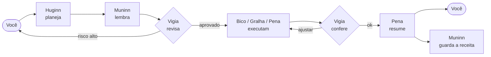

<p align="center">
  <picture>
    <source media="(prefers-color-scheme: dark)" srcset="assets/brand/dotcrow-logo-dark.svg">
    
  </picture>
</p>

<p align="center">
  <strong>Um bando de agentes de IA, open source, que trabalham no seu computador.</strong><br>
  Você delega a tarefa inteira. Os corvos planejam, executam, conferem e aprendem.
</p>

<p align="center">
  <a href="https://github.com/napoleaomp4/dotcrow/actions/workflows/ci.yml"></a>
  <a href="LICENSE"></a>
  
  
  
  
</p>

<p align="center">
  <a href="#-comece-em-2-minutos">Começar</a> ·
  <a href="#-o-que-ele-faz">O que faz</a> ·
  <a href="#-os-corvos">Os corvos</a> ·
  <a href="#-a-civiliza%C3%A7%C3%A3o-dos-corvos-v2">Civilização</a> ·
  <a href="#-quero-ajudar">Contribuir</a> ·
  <a href="docs/arquitetura.md">Arquitetura</a> ·
  <a href="README.en.md">English</a>
</p>

<br>

> [!WARNING]
> **Pré-alfa, e construído em público.** Os corvos já pensam e agem com LLMs de verdade, mas tem muita coisa pela frente e a criptografia ainda não passou por auditoria externa. Não use com dados ou chaves de produção. **Esse é o melhor momento para entrar:** o projeto é pequeno o bastante para você deixar sua marca nele. 🪶

---

## 🐦‍⬛ O que é

Em vez de pedir uma resposta a um chat, você entrega ao **DotCrow** uma tarefa inteira —

> *"organize minha pasta de downloads por cliente e me manda um resumo"*

— e um bando de agentes resolve: um planeja, um lembra como já foi feito antes, um confere os riscos, um executa e um escreve o relatório. Você é o Odin; os corvos trabalham para você.

## ✨ O que ele faz

- 🧠 **Seis corvos, cada um pensa de um jeito.** Eles se revisam entre si antes de qualquer ação, e você vê **cada um pensando ao vivo**, palavra por palavra.
- 🔮 **O Oráculo decide quantos corvos trabalham.** Ele roda no Opus 5.5 e lê cada pedido antes do bando: um *"Oi"* ele mesmo responde, uma tarefa pequena vai para um corvo só, e as grandes vão para os 6, com o conselho dele para dividir o trabalho. Os corvos usam modelos de tokens baratos (claude-haiku-5-5 e gpt-5-nano).
- 🔌 **257 conectores.** X, GitHub, Google Drive, Gmail, Notion, Shopify, Mercado Pago, Telegram, WhatsApp, ViaCEP, IBGE… pela API oficial de cada um, com a chave no cofre. Ler é livre; publicar, enviar e apagar pedem a sua confirmação.
- 🔌 **Qualquer LLM com API.** Claude, GPT, Gemini, OpenRouter, DeepSeek, Groq e modelos locais no Ollama. Acabou a cota de um? O DotCrow **troca para o próximo sozinho**, sem parar a tarefa.
- 💬 **Converse no meio do caminho.** Mudou de ideia enquanto os corvos trabalham? Mande uma mensagem e eles ajustam o rumo na próxima ação.
- ↩️ **Nada de entregar errado.** Se o Vigia não aprovar o resultado, a tarefa **volta ao executor** para refazer — você vê o bando pulando e voltando aos corvos.
- 📱 **No celular, de qualquer lugar.** Um túnel cifrado de ponta a ponta liga o celular ao seu computador pela internet, sem estar no mesmo Wi-Fi. Você acompanha tudo ao vivo pelo app.
- 🎓 **Ensina pelo exemplo.** Grave (com consentimento) alguém fazendo uma tarefa repetitiva — passos, tela, mouse e os sites/programas usados — e isso vira uma *receita* na memória.
- 🔑 **Chaves de API invisíveis.** Só o dono adiciona chaves, e nem ele as vê depois. Não existe comando para exibir uma chave.
- 🔒 **Criptografia pós-quântica.** Esquema híbrido ML-KEM-768 + X25519: para ler, um atacante precisa quebrar os dois.
- 🛑 **Nada irreversível sem você.** Apagar, enviar, pagar, instalar: tudo que não dá para desfazer pede sua confirmação.
- ⌨️ **Modo terminal, dentro do seu projeto.** Rode `dotcrow` na pasta do projeto e os corvos trabalham nos arquivos dali, perguntam o que precisam para acertar e deixam tudo pronto para `/desfazer`. Funciona até no celular, pelo Termux.
- 📱 **Mãos no celular.** Os corvos leem a tela do Android, tocam, rolam, digitam, apertam botões, abrem apps, compartilham um post no X, ligam e mandam SMS (ligar, SMS e tocar em *Postar/Enviar/Pagar/Apagar* sempre pedem a sua confirmação).
- 🎤 **Fale em vez de digitar.** Escreva *"Áudio pra post no Twitter"*, fale, aperte Enter: o DotCrow transcreve e os corvos se viram para fazer.

## 🚀 Comece em 2 minutos

### Baixe pronto (sem compilar)

Pegue na página de [**Releases**](https://github.com/napoleaomp4/dotcrow/releases):

- 🪟 **Windows:** `dotcrow-setup.exe` (instalador de clicar) ou o `dotcrow.exe` portátil.
- 🐧 **Linux (Debian/Ubuntu/Mint):** `sudo apt install ./dotcrow_*_amd64.deb`

### Ou instale do código com um comando (Linux/macOS)

```bash
curl -fsSL https://raw.githubusercontent.com/napoleaomp4/dotcrow/main/instalar.sh | bash
```

Isso instala o Rust, compila e cria o ícone do DotCrow no menu. Clique no ícone (ou rode `dotcrow painel`) e o painel abre no navegador. Daí é só:

1. **Chaves** → cole a chave de API de um provedor (Claude, GPT, Gemini...) e clique em **Testar**.
2. **Tarefas** → peça algo aos corvos e acompanhe cada etapa ao vivo.
3. 📱 Quer no celular? `dotcrow painel --rede` (mesmo Wi-Fi) ou `dotcrow painel --remoto` (de qualquer lugar) e leia o QR.

### ⌨️ Ou use direto no terminal, dentro do projeto

```bash
cd ~/meu-site
dotcrow
```

Num terminal, `dotcrow` abre o **modo terminal** na pasta atual (o ícone continua abrindo o painel):

```
site › troque o título do @notas.php para algo mais amigável
🧭 O Huginn quer alinhar antes de começar:
  1. Mudo só o título ou também o texto da página?
     1) Só o título   2) Os dois
  › 1
▸ 4. Bico · executa no computador…
   ⚙ 1. ler_arquivo: notas.php
   ⚙ 2. editar_arquivo: notas.php
✎ 1 arquivo(s) mexido(s): notas.php · /desfazer volta tudo
```

- **Pastas do projeto:** `/pasta + ~/assets` põe outra pasta (só leitura ou leitura e escrita); `/pastas` mostra todas.
- **Ver arquivos fácil:** `/arquivos` navega pelas pastas do aparelho com números, `/ver notas.php` mostra o arquivo, `/buscar titulo` acha por nome ou conteúdo, `@arquivo` anexa ao pedido e o Tab completa os caminhos.
- **Sempre alinhado:** na primeira vez numa pasta o Huginn faz perguntas sobre o projeto e guarda um perfil; antes de cada tarefa, pergunta o que mudaria o resultado; no meio do trabalho os corvos também podem perguntar.
- **Entregas na Downloads:** relatórios, PDFs, imagens e tudo que não é do projeto vão para a sua pasta Downloads. Fora de um projeto, o DotCrow trabalha na própria Downloads.
- **Sem medo:** os corvos editam só o trecho necessário, apagar arquivo pede confirmação e `/desfazer` volta a última tarefa.
- **No celular:** no Termux, `curl -fsSL https://raw.githubusercontent.com/napoleaomp4/dotcrow/main/instalar-termux.sh | bash`.

Tudo sobre o modo terminal em [docs/terminal.md](docs/terminal.md).

<details>
<summary>Comandos avulsos no terminal 👇</summary>

```bash
dotcrow chaves adicionar anthropic --rotulo "conta pessoal"   # guarda uma chave (sem aparecer na tela)
dotcrow testar                                                 # testa as chaves
dotcrow tarefa "escreva um e-mail avisando que a entrega atrasou dois dias"
dotcrow perguntar "o que é um corvo, em uma frase?"            # resposta direta
dotcrow provedores                                             # ordem e modelos
dotcrow agentes                                                # conheça os corvos
dotcrow civ conversar                                          # os 10 corvos da civilização conversam (v2)
dotcrow audio pra post no Twitter                              # você fala, os corvos fazem
dotcrow celular                                                # o que dá para fazer no Android e como ligar
dotcrow conectores                                             # os 257 serviços com API (X, GitHub, Drive...)
dotcrow conectores adicionar github                            # liga um conector (a chave vai para o cofre)
dotcrow demo troca                                             # veja a troca automática de provedor
```

Para compilar na mão você precisa do [Rust](https://rustup.rs) 1.88+ e de um compilador C:

```bash
cargo build --release && ./target/release/dotcrow painel
```
</details>

## 🪶 Os corvos

Corvos estão entre os animais mais inteligentes que existem: usam ferramentas, resolvem problemas em etapas e **ensinam uns aos outros**. Na mitologia nórdica, Odin tinha dois corvos — **Huginn** (pensamento) e **Muninn** (memória) — que voavam pelo mundo e voltavam contando o que viram.

| Corvo | Papel | Como pensa |
|---|---|---|
| 🧭 **Huginn** | Estrategista | Entende o objetivo e o que significa "pronto" antes de qualquer passo |
| 🧠 **Muninn** | Memória | "Já vi algo parecido, funcionou assim" |
| 🗂️ **Gralha** | Organizadora | Faz o inventário antes de mover qualquer coisa |
| ⚙️ **Bico** | Executor | Faz, confere o resultado real, segue |
| ✍️ **Pena** | Escritora | Escreve pensando em quem vai ler |
| 🛡️ **Vigia** | Guardião | "O que pode dar errado aqui?" |



### 🔮 O Oráculo

Antes do bando, o **Oráculo** (Opus 5.5) lê o pedido e decide quanto ele precisa:

| O pedido | O que acontece |
|---|---|
| *"Oi"*, *"obrigado"*, uma pergunta rápida | o Oráculo responde e nenhum corvo trabalha |
| algo pequeno e sem risco (um texto curto, uma conta, ler um arquivo) | **um corvo só** faz, sem plano nem revisão |
| várias etapas, arquivos importantes, publicar, enviar, pagar, apagar, dinheiro ou dúvida | **os 6 corvos**, com o conselho do Oráculo para dividir o trabalho |

Os corvos usam modelos de tokens baratos: **claude-haiku-5-5** (Anthropic) e **gpt-5-nano** (OpenAI). O Opus fica só para o Oráculo. Sem a chave da Anthropic, o Oráculo usa a fila de provedores. Se você fixou um modelo em `dotcrow provedores modelo`, ele continua valendo; `dotcrow provedores modelo anthropic padrao` volta ao barato.

Mais em [docs/agentes.md](docs/agentes.md).

## 🧬 A Civilização dos Corvos (v2)

Além do bando de tarefas, o DotCrow tem uma **civilização de 10 corvos** que conversam, aprendem, são julgados, morrem e nascem. Cada corvo tem um **genoma** (personalidade, especialidade, geração), **um modelo de LLM próprio** (você escolhe qual, um por um) e **uma memória própria** que fica na sua pasta Downloads.

```bash
dotcrow civ                         # o bando, a situação de cada um e o pódio
dotcrow civ conversar               # os 10 corvos conversam de verdade; você entra na conversa
dotcrow civ conversar --tema música --intervalo 30
dotcrow civ julgar                  # julgamento: 3 jurados + o oráculo (Opus 5.5) + suas notas
dotcrow civ nota Nyx 10             # sua nota para um corvo (0 a 10)
dotcrow civ avaliar                 # o DotCrow pede a sua nota para cada corvo
dotcrow civ pesquisar               # os premiados usam as consultas à internet
dotcrow civ memoria Nyx             # a memória do Nyx e o livro-razão dele
dotcrow civ missao Nyx poste no X o resumo do dia    # o Nyx FAZ, com mãos (PC e celular)
dotcrow civ mortos                  # o Livro dos Mortos
dotcrow civ modelo Nyx anthropic:claude-haiku-5-5    # troca o modelo de um corvo
dotcrow civ nova                    # nova Gênese: 10 corvos novos
dotcrow civ pausar                  # pausa a civilização (o relógio das 24 h para); ficam os 6 corvos
dotcrow civ retomar                 # volta (os prazos somam o tempo parado)
```

**Na conversa** (`dotcrow civ conversar` ou `/civ` no modo terminal):

- 🧠 **Como neurônios:** não há roda fixa. Cada corvo tem uma *ativação* que sobe quando falam com ele, quando perguntam algo a ele, quando o assunto é a especialidade dele, quando está há tempo calado e por espontaneidade, e cai depois que ele fala. Quem dispara fala; às vezes outro só **pensa** (💭, vai para a memória dele). O intervalo entre as falas é irregular.
- 📏 **Cada fala tem um tamanho sorteado**, de 1 a 300 palavras.
- 🗨 **Perguntas viram vínculos:** quando um corvo pergunta algo a outro pelo nome, a resposta fica ligada à pergunta na memória de quem respondeu. É isso que os jurados avaliam.
- ✍️ Escreva e aperte Enter para falar com o bando; chame pelo nome para um corvo responder; `/nota Nyx 10`, `/avaliar`, `/julgar`, `/pesquisar Nyx vulcões`; `pare` encerra.
- 🛠 `/missao Nyx poste no X o lançamento` tira um corvo da conversa para **fazer** (com mãos); o que ele fez volta para o grupo.
- 🎤 `/audio` (ou *"Áudio pra post no Twitter"*) abre o microfone: a sua fala entra na conversa e, se você disse para quê, um corvo vai lá e faz.
- 📣 **A cada 200 falas** o DotCrow pede a sua nota para cada corvo e roda um julgamento.

**O julgamento:**

1. Cada corvo mostra **2 respostas** dele a perguntas que **outro corvo** fez (se faltar, um corvo sorteado pergunta na hora).
2. **3 corvos sorteados** viram jurados e dão nota de 1 a 10 aos outros 9 (ninguém vota em si mesmo).
3. **O oráculo (Opus 5.5)** recebe 1 pergunta e resposta de cada corvo e dá nota de 1 a 10.
4. Entram também **as suas notas** desde o último julgamento. A média decide o ranking:

| Lugar | O que acontece |
|---|---|
| 1º | 🏆 +3 MB de memória e **6 consultas** à internet |
| 2º | 🏆 +2 MB e **4 consultas** |
| 3º | 🏆 +1 MB e **2 consultas** |
| 4º e 5º | continuam |
| 6º ao 10º | ⚰ deixam de existir em **24 h**: a memória (a *alma*) vai para `mortos/`, a lição entra no Livro dos Mortos e nascem 5 novos por cruzamento e mutação dos que ficaram |

**A memória de cada corvo** fica em `Downloads/DotCrow/civilizacao/corvos/<nome>.json` (no Termux, a Download do celular depois de `termux-setup-storage`) e sobrevive a desligar o celular:

- **falas, pensamentos, perguntas respondidas, aprendizados** da internet e **lições**;
- **embeddings** (vetores de ML, `text-embedding-3-small`) nas lembranças importantes: o corvo lembra pelo significado (sem chave da OpenAI, lembra pelas palavras);
- **reflexão:** depois de cada julgamento e a cada 25 falas, o corvo relê o que viveu e escreve lições para ser um agente melhor; as lições guiam as próximas falas. *O modelo em si não é re-treinado (a API não muda os pesos); quem aprende é a memória.*
- **livro-razão** com hash SHA-256 encadeado (nascimento, notas, julgamentos, prêmios, consultas, reflexões, morte). `dotcrow civ memoria Nyx` confere se está íntegro;
- o tamanho respeita a memória do corvo em MB: quando passa, as lembranças mais antigas saem primeiro.

**As consultas à internet** dos premiados vão à Wikipédia, e o que volta passa pela **Alfândega (Opus 5.5)** antes de entrar na memória: texto com instruções para agentes de IA, dados pessoais ou conteúdo perigoso é barrado. Os corvos usam as consultas sozinhos na conversa (`[PESQUISAR: termo]`) ou com `dotcrow civ pesquisar`.

| Fase | O que entra | Estado |
|---|---|---|
| 1 | Motor: Gênese, genoma, desenho, ranking, modelo por corvo | ✅ |
| 1.5 | Conversa de verdade entre os 10 corvos e com você; suas notas | ✅ |
| 2 | Julgamento (3 jurados + oráculo + dono), prêmios, morte em 24 h e nascimentos, memória própria com embeddings e livro-razão, reflexão, conversa como neurônios, consultas com Alfândega | ✅ no código |
| 3 | Missões: os corvos fazem no celular e no computador o que uma pessoa faz (arquivos, programas, terminal, SSH, navegador, mouse e teclado; no Android: ler a tela, tocar, rolar, digitar, botões, print, apps, ligar, SMS), áudio do dono transcrito | ✅ no código |
| 4 | 257 conectores (X, Google Drive, GitHub…) com as chaves no cofre; o Oráculo divide as tarefas; pausar a civilização | ✅ no código |
| 5 | Muralha (anonimização), Conselho com voto (>60%), alma exportável, painel estilo WhatsApp | 🟡 |

### 📱 Os corvos no celular

Os corvos não enxergam imagens: eles **leem a árvore da tela** do Android (cada botão e texto, com a posição) e tocam pelo texto — `tocar {texto: "Postar"}` — sem adivinhar coordenadas.

| Ferramenta | O que faz | Precisa |
|---|---|---|
| `celular` | `tela`, `tocar`, `segurar`, `rolar`, `deslizar`, `digitar`, `tecla` (voltar, início, enter…), `abrir` app, `compartilhar` (ex.: post no X), `link`, `print`, `apps` | ADB |
| `ligar` · `sms` | ligação normal e SMS | Termux:API (ou ADB) |
| `falar` · `ouvir` · `notificar` | voz alta, microfone, notificação | Termux:API |

No Termux, uma vez só:

```bash
pkg install android-tools termux-api        # e instale o app Termux:API (F-Droid)
# Opções do desenvolvedor → Depuração sem fio → "Parear o dispositivo com um código"
adb pair IP:PORTA CÓDIGO
adb connect IP:PORTA
dotcrow celular                             # confere o que está pronto
```

No PC, basta o celular no cabo USB com a Depuração USB ligada. **Ligar, mandar SMS e tocar em botões de publicar, enviar, pagar ou apagar pedem a sua confirmação sempre — até no modo livre.** O microfone também pergunta.

### 🎤 Áudio

`/audio` no modo terminal (ou escreva *"Áudio pra post no Twitter"*), ou `dotcrow audio pra post no Twitter`: o microfone abre, você fala e aperta Enter. A transcrição usa a sua chave da OpenAI (`gpt-4o-mini-transcribe`) ou, sem ela, a do Groq (Whisper), e vira o pedido para os corvos — que finalizam o texto e publicam pelo caminho que existir (o celular, o navegador, uma API), pedindo a sua confirmação antes de publicar. Os áudios ficam em `Downloads/DotCrow/audios`. Grava pelo Termux:API no celular e por `arecord`, SoX ou `ffmpeg` no computador.

### 🔌 Conectores

São **257 serviços** com API, em 18 categorias: código (GitHub, GitLab, Jira…), nuvem (Vercel, Cloudflare, Hostinger, DigitalOcean…), projetos (Notion, Trello, Asana, ClickUp, Airtable…), arquivos (Google Drive, Dropbox, OneDrive…), e-mail e agenda (Gmail, Google Agenda, Outlook, Brevo, Mailchimp…), mensagens (Telegram, Discord, Slack, WhatsApp Cloud API, Evolution API, Chatwoot…), redes sociais (X, LinkedIn, Instagram, YouTube, TikTok…), lojas e pagamentos (Shopify, WooCommerce, Nuvemshop, Mercado Livre, Mercado Pago, Stripe, Asaas…), IA e dados, busca, clima, mapas e dados públicos do Brasil (ViaCEP, BrasilAPI, IBGE, Banco Central, Câmara, Senado…).

```bash
dotcrow conectores                          # o catálogo, com o que já está ligado
dotcrow conectores listar brasil            # busca por nome ou categoria
dotcrow conectores ver shopify              # endereço da API, formato da chave e onde pegar
dotcrow conectores adicionar github         # cola o token (não aparece na tela)
dotcrow conectores adicionar shopify --conta minhaloja.myshopify.com
dotcrow conectores testar github            # uma leitura de teste
dotcrow conectores remover github
```

- A chave vai para o **mesmo cofre cifrado** das chaves de LLM (`con-<serviço>`) e nunca é mostrada. Os corvos usam a ferramenta `conector {servico, metodo, caminho, consulta, corpo}`: a chave entra no pedido só na hora, e é apagada de qualquer resposta.
- Só dá para falar com o **endereço oficial** de cada serviço: o caminho não troca de site.
- **Ler (GET) é livre. Escrever (POST, PUT, PATCH, DELETE) pede a sua confirmação sempre**, até no modo livre.
- 24 conectores são **públicos** e já funcionam sem chave (ViaCEP, BrasilAPI, IBGE, Banco Central, Open-Meteo, Wikipédia, OpenStreetMap…).
- Serviços que só dão token por OAuth (Google, Microsoft, X…) aceitam, por enquanto, um token de acesso que você cola. Ele expira, e aí é só adicionar de novo. Um token do Google vale para Gmail, Drive, Agenda, Planilhas e YouTube.

## 🧩 O que já funciona

| Parte | Estado |
|---|---|
| Painel no navegador e no celular, com os corvos pensando ao vivo | ✅ |
| Celular pela internet, com túnel cifrado de ponta a ponta ([docs](docs/remoto.md)) | ✅ |
| Provedores reais: Claude, GPT, Gemini, OpenRouter, DeepSeek, Groq, Ollama | ✅ |
| Troca automática entre LLMs quando um falha | ✅ |
| Corvos agindo no computador (terminal, arquivos, navegador, mouse, teclado) | ✅ |
| Corvos agindo no celular Android: tela, toques, rolagem, digitação, botões, apps, ligações e SMS (`dotcrow celular`) | ✅ |
| Áudio do dono transcrito virando tarefa (`/audio`, `dotcrow audio`) | ✅ |
| 257 conectores pela API oficial, com a chave no cofre (`dotcrow conectores`) | ✅ |
| O Oráculo (Opus 5.5) decide quantos corvos trabalham; corvos em modelos baratos | ✅ |
| Modo terminal na pasta do projeto, com perguntas, @anexos, pastas extras e desfazer ([docs](docs/terminal.md)) | ✅ |
| Android pelo Termux | ✅ |
| Conversa ao vivo e o Vigia mandando refazer | ✅ |
| Modo treinamento (vira memória/RAG), com consentimento | ✅ |
| Cofre de chaves cifrado + envelope pós-quântico (**não auditado**) | ✅ |
| Civilização dos Corvos v2: 10 corvos que conversam, são julgados (jurados + oráculo + você), aprendem com memória própria e nascem/morrem (`dotcrow civ`) | ✅ |
| WhatsApp, app nativo e marketplace de RAGs | 🟡 a caminho — veja o [ROADMAP](ROADMAP.md) |

## 🤝 Quero ajudar

Toda ajuda conta: código, testes, documentação, tradução, revisão de segurança ou só testar e abrir issues. Não precisa ser sênior — precisa ter vontade. 💚

1. Leia o [guia de contribuição](CONTRIBUTING.md) (é curtinho).
2. Pegue uma issue [`boa-primeira-issue`](https://github.com/napoleaomp4/dotcrow/labels/boa-primeira-issue) ou [`ajuda-bem-vinda`](https://github.com/napoleaomp4/dotcrow/labels/ajuda-bem-vinda).
3. Comente na issue que vai pegar, para ninguém fazer em dobro.

**Bons primeiros lugares:** um provedor novo compatível com a OpenAI (Mistral, xAI...), a ponte com o WhatsApp pela [API do painel](docs/painel.md), o app nativo falando o [protocolo remoto](docs/remoto.md), ou testes de *prompt injection* para o Vigia.

## 🗂️ Estrutura

```
crates/
  dotcrow-core/        permissões, riscos e política de confirmação
  dotcrow-crypto/      envelope híbrido pós-quântico e cifra simétrica
  dotcrow-vault/       cofre de chaves de API (só escreve, nunca mostra)
  dotcrow-providers/   adaptadores de LLM + roteador com troca automática
  dotcrow-agents/      os seis corvos, o fluxo, o orquestrador e a civilização dos 10 corvos
  dotcrow-cli/         o comando dotcrow, o painel e o túnel remoto
  dotcrow-relay/       o relay do túnel (roda na nuvem; só repassa bytes)
docs/                  arquitetura, agentes, segurança, painel e API, remoto
```

## 🔐 Segurança

Achou uma falha? **Não abra issue pública.** Siga o [SECURITY.md](SECURITY.md). O modelo de ameaças e os detalhes da criptografia estão em [docs/seguranca.md](docs/seguranca.md).

## 📄 Licença

Código sob a [Licença Apache 2.0](LICENSE). O nome DotCrow e o logo identificam o projeto oficial; veja [assets/brand/README.md](assets/brand/README.md).

---

<p align="center">
  Criado por <a href="https://github.com/napoleaomp4">Napoleão Junior</a> em Buriticupu, Maranhão 🇧🇷<br>
  <a href="https://x.com/napoleaomp4">@napoleaomp4</a> · <a href="https://dotcrow.si">dotcrow.si</a><br>
  <sub>Se curtir a ideia, deixa uma ⭐ — ajuda demais um projeto pequeno a crescer.</sub>
</p>
