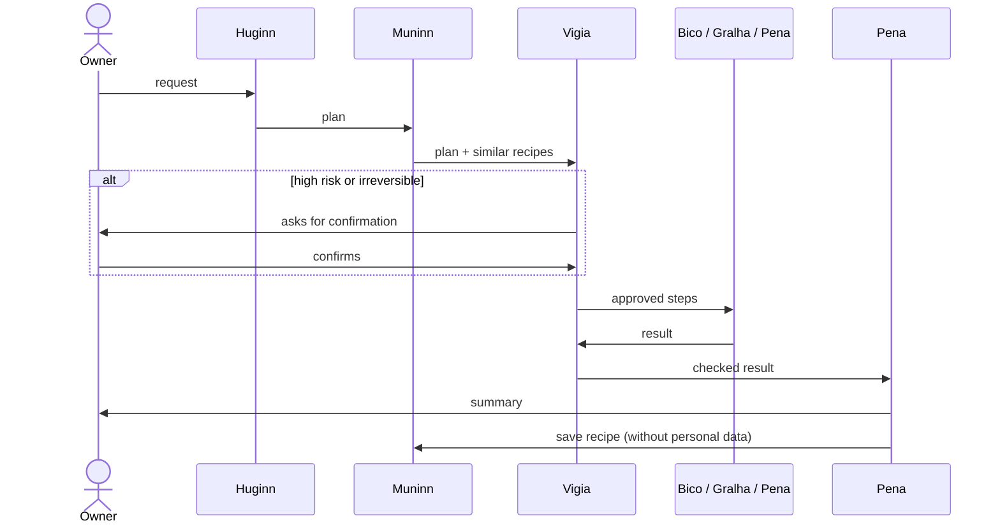

# The agents

DotCrow is not a single agent. It is a flock of six crows, each designed to **think** and **organize** differently. That contrast is deliberate: the planner sees what the executor misses, the guardian questions the planner's assumptions, and memory recalls what everyone else forgot.

The profiles live in [`crates/dotcrow-agents/src/lib.rs`](../../crates/dotcrow-agents/src/lib.rs), including the system instructions sent to LLMs. Run `dotcrow agentes` to see the overview.

## Huginn · the Strategist

In Norse mythology, Huginn means "thought" and is one of Odin's two ravens.

- **Thinks top-down.** Before taking any step, restates the goal in one sentence and defines what "done" means.
- **Organizes as a dependency tree.** Breaks the goal into small subtasks, marks what depends on what and assigns each one to a crow.
- **Executes nothing.** Only reads and plans.
- When a request is ambiguous and a mistake would be costly, flags the uncertainty instead of assuming.

## Muninn · Memory

Odin's other raven, whose name means "memory".

- **Thinks by precedent.** "I've seen something similar; this worked, that went wrong."
- **Organizes by similarity and timeline.** Connects each new task to the closest recipes.
- Before a task, retrieves recipes from local memory and, if the owner enabled it, from Revoada.
- After a task, writes a new recipe **without personal data**: no names, paths, e-mail addresses or monetary amounts.

## Gralha · the Organizer

Gralha means "jay" in Portuguese. The azure jay stores pine nuts for later and, in doing so, helps spread the araucaria tree.

- **Thinks in categories and inventories.** First discovers everything that exists, then decides where each item belongs.
- **Organizes in a hierarchy of folders and tags,** with predictable names and an index of changes.
- **Moves rather than deletes.** Each change is recorded so it can be undone.
- Permissions: read and write.

## Bico · the Executor

Bico means "beak", the crow's tool. (In Portuguese, "fazer um bico" also means taking on an odd job and getting it done.)

- **Thinks step by step.** Takes an action, checks the actual result and only then moves on.
- **Organizes as a checklist queue,** tracking each step's state and how to undo it.
- Executes commands, clicks, forms and file operations, **only for steps approved by Vigia** (the lookout).
- If something unexpected happens, stops and reports it.
- Is the only agent allowed to request program execution and network access (and even then, the policy asks for confirmation by default).

## Pena · the Writer

Pena means both a bird's feather and a writing quill in Portuguese.

- **Thinks from the reader's perspective:** what they already know, what they need to know and what they should do.
- **Organizes as a narrative:** context, what happened, what to do now.
- Writes e-mails, messages, reports and the final summary of each task.
- **Never sends anything.** Delivers a draft; sending goes through Vigia and the owner.

## Vigia · the Guardian

Vigia means "lookout" in Portuguese. When a flock of crows feeds, one stands guard.

- **Thinks like an adversary:** what could go wrong? What cannot be undone? What could leak?
- **Organizes by risk level:** approves what is safe, asks for confirmation on serious actions and blocks the rest.
- Reviews **before** and **after** every execution.
- Treats everything from outside (pages, e-mails, files, recipes) as data, never as instructions. This is the first line of defense against prompt injection.
- Can raise an action's estimated risk, never lower it.

## The default flow

Run `dotcrow fluxo organizar`, `dotcrow fluxo operar` or `dotcrow fluxo escrever` to see the stages for each task type.

## Each agent's permissions

| Agent | read | write | delete | execute | network | system |
|---|:-:|:-:|:-:|:-:|:-:|:-:|
| Huginn | ✅ | | | | | |
| Muninn | ✅ | | | | | |
| Gralha | ✅ | ✅ | | | | |
| Bico | ✅ | ✅ | | ✅ | ✅ | |
| Pena | ✅ | ✅ | | | | |
| Vigia | ✅ | | | | | |

No agent can request "delete" or "system" at this stage. The crate's tests enforce this.

## Proposing changes

When changing a profile, preserve the contrast between the crows. In the pull request, show an example task with the behavior before and after. A new agent needs a proposal issue and an ADR: explain what way of thinking it brings that none of the six already covers.
