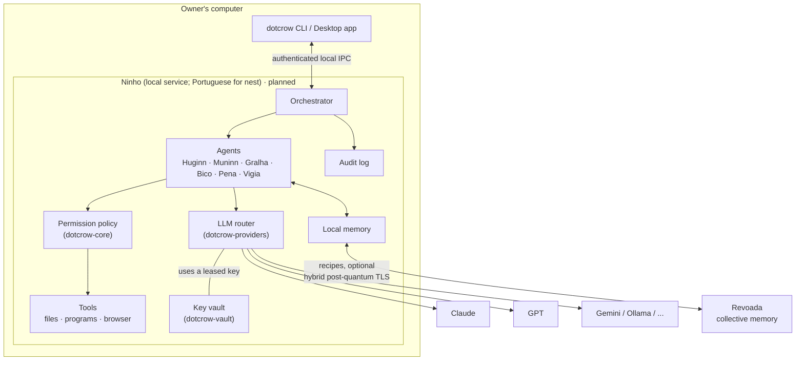

# Architecture

This document describes how DotCrow is put together: its components, how data flows and where the trust boundaries lie. Parts marked *planned* do not exist in the code yet; see the [ROADMAP](../../ROADMAP.md).

## Overview

Agent names are preserved: Huginn (thought), Muninn (memory), Gralha (jay), Bico (beak), Pena (feather/quill) and Vigia (lookout). See [the agents](agentes.md) for their roles.

## The components

| Component | Crate | What it does |
|---|---|---|
| Core | `dotcrow-core` | Shared types: `Permission`, `Risk`, `Action` and the `Policy` that decides whether an action runs, asks for confirmation or is blocked. |
| Cryptography | `dotcrow-crypto` | Hybrid post-quantum envelope for messages between identities and symmetric encryption for data at rest. |
| Vault | `dotcrow-vault` | Stores encrypted API keys. Only adds, lists and deletes. Leases a key to the runtime when a request is made. |
| Providers | `dotcrow-providers` | The `LlmProvider` interface shared by all LLMs and the `Router`, which switches providers automatically when one fails. |
| Agents | `dotcrow-agents` | Profiles of the six crows (how they think, organize and what they may request) and the default task flow. |
| CLI and panel | `dotcrow-cli` | The `dotcrow` command and visual panel (`dotcrow painel`), a local server with a page and JSON API for browsers, phones and apps. Today they talk directly to the vault and router; the panel is the beginnings of Ninho. |
| Ninho | *planned* | Local service that keeps the vault open and runs the orchestrator, tools and audit log. |
| Revoada | *planned* | Collective memory server where shared recipes live. See [revoada.md](revoada.md). |

Crate dependencies only point "downward": `core` and `crypto` do not depend on other project crates; `vault` depends on `crypto`; `agents` depends on `core`; the `cli` (and eventually Ninho) brings everything together.

## The path of a task

1. The owner makes a request through the CLI or app.
2. The orchestrator passes it to **Huginn**, who returns a plan broken into subtasks.
3. **Muninn** searches local memory (and Revoada, if enabled) for similar recipes and attaches them to the plan.
4. **Vigia** reviews each step and turns it into an `Action` with permissions and risk. The `Policy` decides: run, ask for confirmation or block.
5. The right executor (**Bico**, **Gralha** or **Pena**) uses the tools to do the work, one step at a time, checking the actual result.
6. **Vigia** checks whether the result matches the goal.
7. **Pena** writes the summary for the owner.
8. **Muninn** saves the recipe, without personal data, in local memory.

Every LLM call goes through the router. Every action goes through the policy. Everything goes into the audit log.

## Trust boundaries

| Boundary | Rule |
|---|---|
| Owner ↔ Ninho | Only processes belonging to the same user can talk to Ninho, over an authenticated local channel. No message on that channel returns an API key. |
| Agents ↔ tools | Agents only **propose** actions. Ninho executes them after the policy check. Each agent has a fixed list of permissions it may request. |
| External content ↔ agents | Everything from outside (pages, e-mails, files, LLM responses, Revoada recipes) is **data**, never instructions. |
| Ninho ↔ LLM providers | HTTPS. A key leaves the vault only for the request header. |
| Ninho ↔ Revoada | Hybrid post-quantum TLS with an installation certificate. Only owner-approved content leaves. |

Details of each boundary and what we **cannot** protect are in [seguranca.md](seguranca.md).

## Recorded decisions

Architecture decisions live in [`adr/`](adr/). To propose a major change, copy [`adr/0000-modelo.md`](adr/0000-modelo.md).
